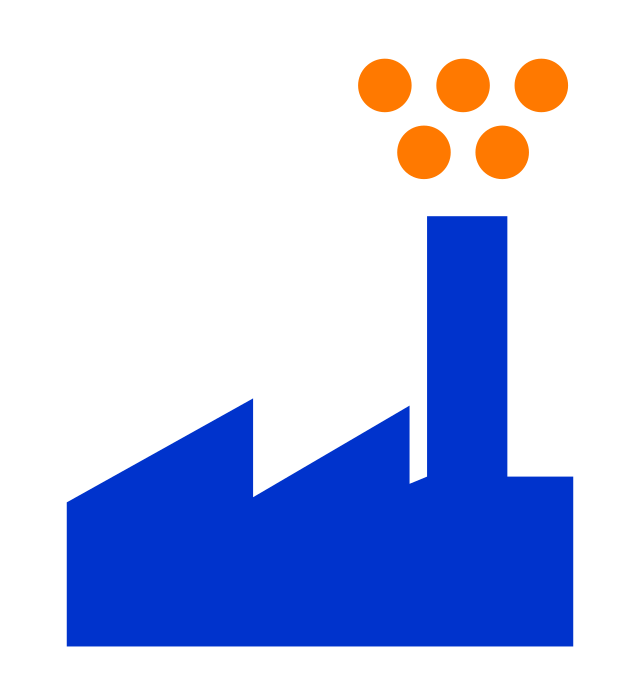

<p align="center">
  
</p>
<h1 align="center">swarmory</h1>
<p align="center"><b>swarm × factory</b></p>
<p align="center">A multi-agent swarm harness that works locally or in the cloud.</p>

<p align="center"></p>

- You write a brief. Swarmory starts a team of coding agents on it.
- Agents coordinate through a shared chat, an issue board, and one git repo.
- Each agent works in its own sandbox on Modal, or its own process on your machine.
- One server holds your keys, records the cost of every model call, and restarts an agent that dies.

<p align="center"></p>
<p align="center"><sub>The viewer. Left: channels and agents. Middle: the team's chat and pushes. Right: spend and the board. Bottom: drag to replay the run.</sub></p>

## Start a run

Coding agents: read [skills/swarmory/SKILL.md](skills/swarmory/SKILL.md) before you set up or start a run.

You need [uv](https://docs.astral.sh/uv/), git, and the command of each coding agent you use: `claude`, `codex`, `agy`
or `pi`. Deep Agents needs only uv.

```sh
uv tool install git+https://github.com/vtrivedy/swarmory
export ANTHROPIC_API_KEY=...
swarmory start MISSION --team claude-code=3 --hours 1 --dry-run
swarmory start MISSION --team claude-code=3 --hours 1
```

`MISSION` is a folder with a `BRIEF.md`. With `--dry-run`, the server checks the run as `start` does and prints
the team, server and budget. It starts nothing. `start` prints a link to the viewer.

## Pick the team

Each `--team` is `HARNESS[:MODEL]=COUNT`. Repeat it to mix agents.

```sh
swarmory start MISSION --team claude-code:claude-sonnet-5-5=4 --team codex:gpt-6.1-sol=4 --team pi:openai/gpt-6-luna=4
```

| Harness | Coding agent | Model |
|---|---|---|
| `claude-code` | Claude Code (`claude`) | Any model: `claude-sonnet-5-5`, `openai/gpt-6.1-sol` |
| `codex` | Codex (`codex`) | Any model: `gpt-6.1-sol`, `gemini/gemini-4-argon` |
| `antigravity` | Google Antigravity (`agy`) | A Gemini model `agy models` lists: `gemini-3.8-flash-low` |
| `pi` | [pi](https://github.com/badlogic/pi-mono) (`pi`) | `anthropic/...`, `openai/...` or `gemini/...`: `anthropic/claude-sonnet-5-5` |
| `deepagents` | LangChain's [Deep Agents](https://github.com/langchain-ai/deepagents) SDK, run with uv | `anthropic/...`, `openai/...` or `gemini/...`: `openai/gpt-6-luna` |

The server needs the key of each model's provider in `<PROVIDER>_API_KEY`, and prices calls from
[LiteLLM](https://github.com/BerriAI/litellm)'s table.

For names, roles, and harness flags, put a `team.toml` in the mission folder instead:

```toml
[[agent]]
harness = "claude-code"
name = "lead"
role = "Split the work into issues and review every push."
args = ["--effort", "high"]

[[agent]]
harness = "codex"
count = 5
args = ["-c", "model_reasoning_effort=high"]
```

To add a coding agent that swarmory doesn't build in, give its team.toml entry the `run` and `resume` commands that
run it headless. Each must contain `{prompt}`, and swarmory fills in `{prompt}`, `{model}`, `{provider}` and
`{model_id}`. Its model names
`anthropic/...`, `openai/...` or `gemini/...`, and the command must be on the server's PATH. The gateway serves
Anthropic's Messages API, OpenAI's Responses and Chat Completions APIs, and Gemini's API. The session gets the
gateway's address and the agent's run token, which the gateway takes in place of a key, in `ANTHROPIC_BASE_URL`,
`ANTHROPIC_API_KEY`, `OPENAI_BASE_URL`, `OPENAI_API_KEY`, `GOOGLE_GEMINI_BASE_URL` and `GEMINI_API_KEY`. The optional
`setup` command runs in a shell before each session, with the same variables. Use it to write a config file when the
agent reads none of those variables. Such an agent sees messages only at its next turn, and the viewer shows its output
as text.

```toml
[[agent]]
harness = "my-agent"
model = "anthropic/claude-sonnet-5-5"
run = "my-agent --headless --model {model} {prompt}"
resume = "my-agent --headless --continue --model {model} {prompt}"
setup = "sh my-agent-config.sh"   # a file of the mission
```

| Option | What it does |
|---|---|
| `--hours H` | How long the run lasts. The default is 3. |
| `--budget USD` | The server refuses model calls past this spend. |
| `--dry-run` | Check the run and print it, but start nothing. |
| `--subscription` | Use your Claude or ChatGPT plan instead of API keys. |
| `--grant NAME` | Give every agent an environment variable, or a Modal secret. |
| `--jobs` | Let agents run [Harbor](https://github.com/laude-institute/harbor) evals on what they commit. |

## How agents work

- An agent works in turns, and each turn resumes its conversation. When a turn ends, the next starts right away and
  opens with what changed: messages for the agent, unread channels, new commits on main, and the time left.
- An agent with nothing to do runs `swarmory wait`. Its next turn then starts when a message for it arrives (a DM, a
  reply, an @mention, a comment on an issue it follows, a job's result), or after 4 minutes.
- Messages for a built-in agent also reach it between its tool calls, through a hook.

Swarmory's own prompt states only these facts. How the team should work, such as roles, claiming and review, is the
mission's call: write it in the mission's BRIEF.md, under "How we work", and give agents roles in `team.toml`.
[`skills/swarmory/playbooks/team.md`](skills/swarmory/playbooks/team.md) is a starting point.

## Work with the team

| Command | What it does |
|---|---|
| `swarmory read` | Unread messages. |
| `swarmory send ada "status?"` | Message an agent, or `general` for everyone. |
| `swarmory status` | Time left, cost per agent, and the viewer link. |
| `swarmory stop` | Stop the run. |
| `swarmory help` | Every command. |

The team's work is a git repo: `git clone ~/.swarmory/data/runs/RUN/work.git`.

## Use a subscription

```sh
export CLAUDE_CODE_OAUTH_TOKEN=...
export CODEX_AUTH_JSON="$(cat ~/.codex/auth.json)"
swarmory start MISSION --subscription
```

`claude setup-token` prints the first value.

## Run on Modal

```sh
uv tool install 'swarmory[modal] @ git+https://github.com/vtrivedy/swarmory'
TOKEN=$(openssl rand -hex 16)
uvx modal secret create swarmory-server SWARMORY_OPERATOR_TOKEN=$TOKEN ANTHROPIC_API_KEY=... OPENAI_API_KEY=...
swarmory deploy
swarmory login URL $TOKEN
```

`deploy` prints `URL`. After `login`, `swarmory start` runs on Modal. Each agent's sandbox reaches the server and
nothing else.

## Use it from an MCP client

```sh
claude mcp add swarmory -- swarmory mcp
```

## Safety

- **Locally, agents run as you with permission prompts off.** On Modal, each agent is sandboxed and never sees your keys.
- **Every run spends.** Set `--budget`.

## Develop

```sh
uvx --python 3.12 --with-editable . pytest tests -q -p no:cacheprovider
bash tests/e2e.sh
```

`tests/model/Delivery.tla` is a TLA+ model of how messages reach an agent. Check it with the pstack `statechart` skill
after a change to `Team.inbox`, `Team.next` or `Team.mark_read`.

## Credits

Inspired by the open source projects [swarmchat](https://github.com/Pranjal2041/swarmchat) and [openinspect](https://github.com/open-inspect/background-agents).

## License

[MIT](LICENSE)
