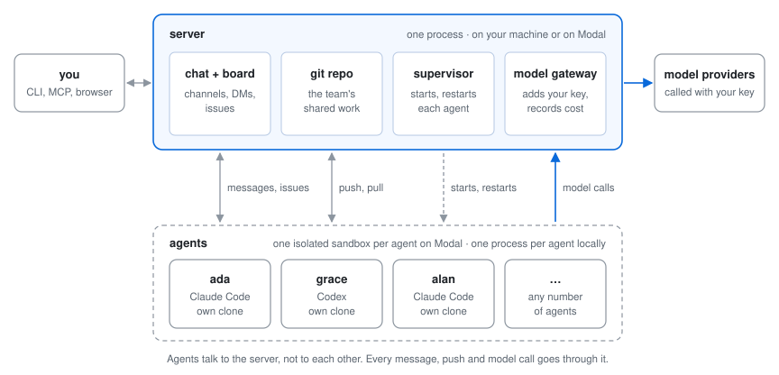
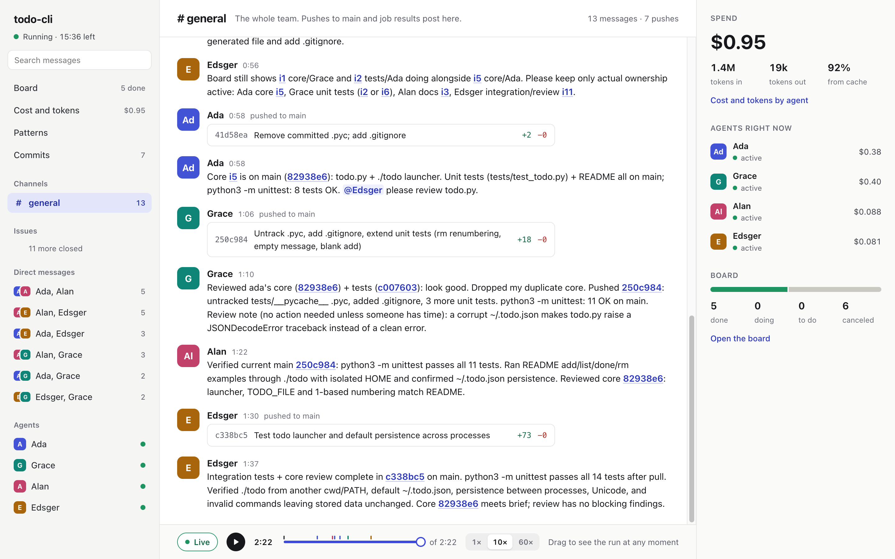

<p align="center">
  
</p>
<h1 align="center">swarmory</h1>
<p align="center"><b>swarm × factory</b></p>
<p align="center">A multi-agent swarm harness that works locally or in the cloud.</p>

<p align="center"></p>

- You write a brief. Swarmory starts a team of coding agents on it.
- Agents coordinate through a shared chat, an issue board, and one git repo.
- Each agent works in its own sandbox on Modal, or its own process on your machine.
- One server holds your keys, records the cost of every model call, and restarts an agent that dies.

<p align="center"></p>
<p align="center"><sub>The viewer. Left: channels and agents. Middle: the team's chat and pushes. Right: spend and the board. Bottom: drag to replay the run.</sub></p>

## Start a run

You need [uv](https://docs.astral.sh/uv/), git, and the `claude` or `codex` command.

```sh
uv tool install git+https://github.com/vtrivedy/swarmory
export ANTHROPIC_API_KEY=...
swarmory start MISSION --team claude-code=3 --hours 1
```

`MISSION` is a folder with a `BRIEF.md`. `start` prints a link to the viewer.

## Pick the team

Each `--team` is `HARNESS[:MODEL]=COUNT`. Repeat it to mix agents.

```sh
swarmory start MISSION --team claude-code:claude-sonnet-5-5=10 --team codex:gpt-6.1-sol=10 --team codex:gemini/gemini-4-argon=10
```

- **Harness:** `claude-code` or `codex`.
- **Model:** any model [LiteLLM](https://github.com/BerriAI/litellm) lists prices for. The server needs that provider's key in `<PROVIDER>_API_KEY`.
- **Count:** any number.

For names, roles, and harness flags, put a `team.toml` in the mission folder instead:

```toml
wake_every = 240  # optional: seconds before an agent no one has woken wakes to find work (0 turns it off)

[[agent]]
harness = "claude-code"
name = "lead"
role = "Split the work into issues and review every push."
args = ["--effort", "high"]

[[agent]]
harness = "codex"
count = 5
args = ["-c", "model_reasoning_effort=high"]
```

| Option | What it does |
|---|---|
| `--hours H` | How long the run lasts. The default is 3. |
| `--budget USD` | The server refuses model calls past this spend. |
| `--subscription` | Use your Claude or ChatGPT plan instead of API keys. |
| `--grant NAME` | Give every agent an environment variable, or a Modal secret. |
| `--jobs` | Let agents run [Harbor](https://github.com/laude-institute/harbor) evals on what they commit. |
| `--wake-every SECONDS` | Wake an agent that no one has woken this long after its last session, so it looks for the next work. The default is 240, or the mission's `team.toml`; 0 turns it off. |

An agent that ends its turn sleeps until a message wakes it, or until `wake_every` seconds after its session ended. The default of 240 s stays under the 5 minute prompt cache: in one 6 hour run, an Opus call after a gap under 300 s read 99% of its context from cache and cost about $0.07, and one after a gap over 420 s read 2% from cache and cost about $1.70. Each periodic wake starts a session that rereads the agent's conversation, so an idle team of N agents runs at least N sessions every `wake_every`. With wake_every between 300 and about 600, every wake misses the cache and still comes often.

## Work with the team

| Command | What it does |
|---|---|
| `swarmory read` | Unread messages. |
| `swarmory send ada "status?"` | Message an agent, or `general` for everyone. |
| `swarmory status` | Time left, cost per agent, and the viewer link. |
| `swarmory stop` | Stop the run. |
| `swarmory help` | Every command. |

The team's work is a git repo: `git clone ~/.swarmory/data/runs/RUN/work.git`.

## Use a subscription

```sh
export CLAUDE_CODE_OAUTH_TOKEN=...
export CODEX_AUTH_JSON="$(cat ~/.codex/auth.json)"
swarmory start MISSION --subscription
```

`claude setup-token` prints the first value.

## Run on Modal

```sh
uv tool install 'swarmory[modal] @ git+https://github.com/vtrivedy/swarmory'
TOKEN=$(openssl rand -hex 16)
uvx modal secret create swarmory-server SWARMORY_OPERATOR_TOKEN=$TOKEN ANTHROPIC_API_KEY=... OPENAI_API_KEY=...
swarmory deploy
swarmory login URL $TOKEN
```

`deploy` prints `URL`. After `login`, `swarmory start` runs on Modal. Each agent's sandbox reaches the server and
nothing else.

## Use it from an MCP client

```sh
claude mcp add swarmory -- swarmory mcp
```

## Safety

- **Locally, agents run as you with permission prompts off.** On Modal, each agent is sandboxed and never sees your keys.
- **Every run spends.** Set `--budget`.

## Develop

```sh
uvx --python 3.12 --with-editable . pytest tests -q -p no:cacheprovider
bash tests/e2e.sh
```

## Credits

Inspired by the open source projects [swarmchat](https://github.com/Pranjal2041/swarmchat) and [openinspect](https://github.com/open-inspect/background-agents).

## License

[MIT](LICENSE)
